<div align="center">

# 🏛️ Spillburg Group — Corporate Profile Suites (2026 Edition)

[](https://github.com/muhzahjr07/spillburg_profiles/actions/workflows/deploy-pages.yml)
[](https://github.com/muhzahjr07/spillburg_profiles/releases/tag/v1.0.0)
[](docs/DESIGN_SYSTEM.md)
[](docs/DEPLOYMENT.md)
[](#license)

**Comprehensive 2026 corporate profiles, digital pitch decks, 300 DPI print publications, and Figma vector assets for the Spillburg Group conglomerate.**

[🌐 Live Showcase Portal](https://muhzahjr07.github.io/spillburg_profiles/docs/) • [🎨 Design System](docs/DESIGN_SYSTEM.md) • [🚀 Deployment Guide](docs/DEPLOYMENT.md) • [📦 Releases](docs/RELEASES.md)

---

</div>

## 📌 Executive Overview

This repository hosts the synchronized 2026 identity and publication assets for the **Spillburg Group** across four corporate entities. Each profile is crafted with an authentic visual identity, verified leadership profiles, website-sourced service taxonomies, and multi-format delivery (Figma Vector SVGs, Master PDFs, PowerPoint decks, and responsive HTML5/CSS3 sources).

| Entity | Authentic Tagline | Official Domain | Core Practice |
| :--- | :--- | :--- | :--- |
| **Spillburg Holdings (Pvt) Ltd** | *"We Make It Happen"* | [spillburg.com](https://spillburg.com) | Group Conglomerate & Industrial Investments |
| **Destination Consultancy (Pvt) Ltd** | *"Success Beyond Boundaries"* | [destinationconsultancy.com](https://www.destinationconsultancy.com) | Cross-Border FDI, BOI Incentives & M&A |
| **Spillburg Corporate Services (Pvt) Ltd** | *"Compliance. Assurance. Accelerate Growth."* | [spillburgcorporate.com](https://www.spillburgcorporate.com) | Secretarial, Statutory Audit, Tax & Governance |
| **Spillburg Logistics 1 (Pvt) Ltd** | *"Moving Cargo. Connecting Businesses."* | [spillburglogistics1.com](https://www.spillburglogistics1.com) | Ocean/Air Freight, ASYCUDA Customs & 3PL |

---

## 📸 Visual Showcase & Previews

### 1. Destination Consultancy (Pvt) Ltd
*Theme: Deep Petrol (`#071E2B`) & Sovereign Gold (`#C59B27`)*

| Page 01: Cover Presentation | Page 03: Executive Leadership |
| :---: | :---: |
| 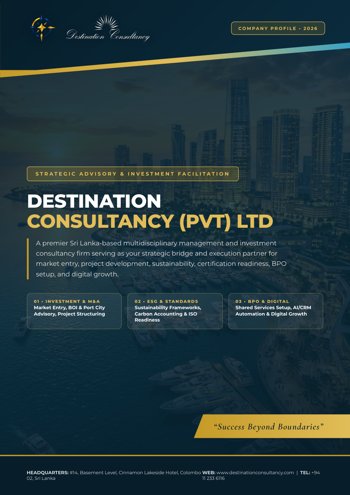 | 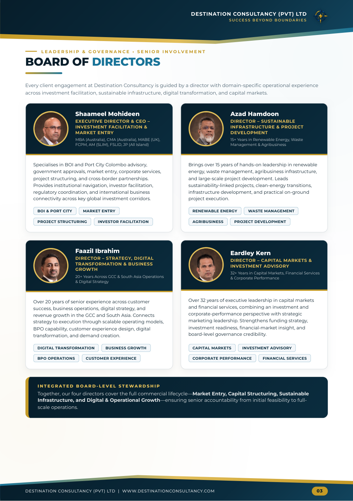 |
| **Page 06: Why Sri Lanka (5-Hub Vision)** | **Page 08: Representative Mandates** |
| 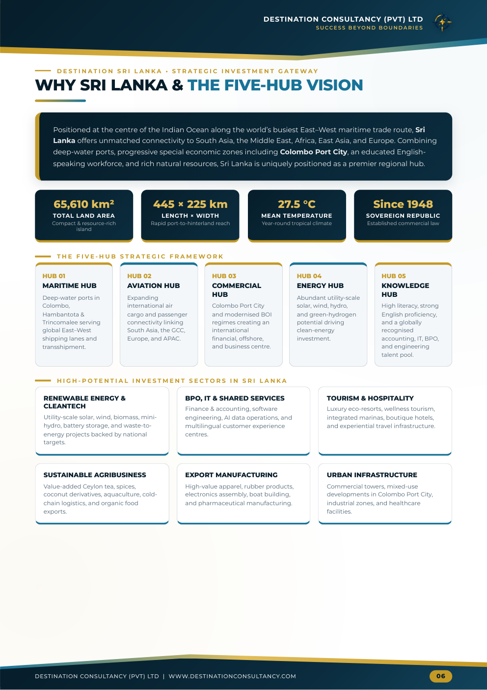 | 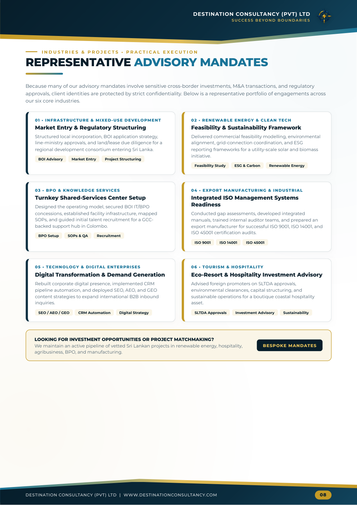 |

---

### 2. Spillburg Corporate Services (Pvt) Ltd
*Theme: Swiss Legal-Editorial, Royal Midnight (`#030712`) & Electric Cobalt (`#173DED`)*

| Page 01: Split-Hero Cover | Page 03: Board of Directors |
| :---: | :---: |
| 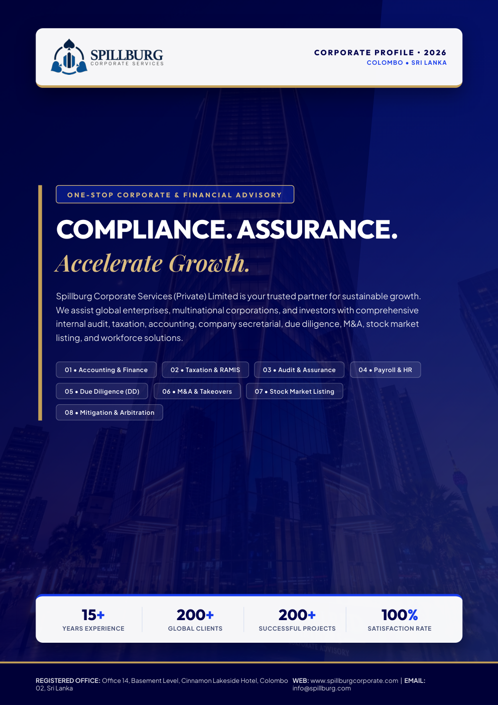 | 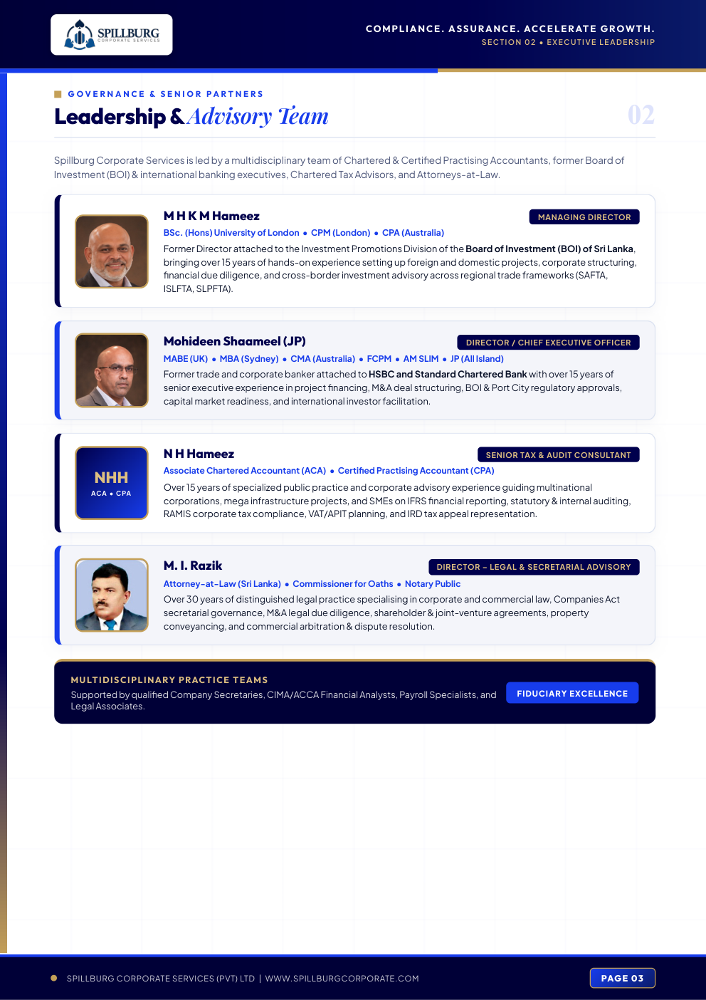 |
| **Page 06: Statutory Audit & Compliance** | **Page 08: Incorporation & Client Portfolio** |
| 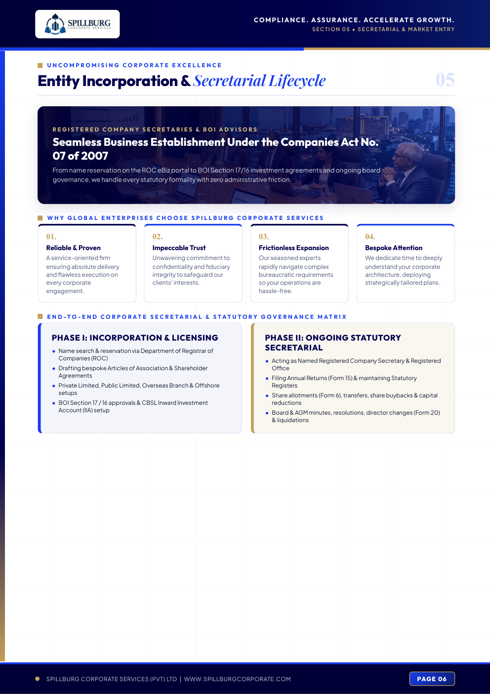 | 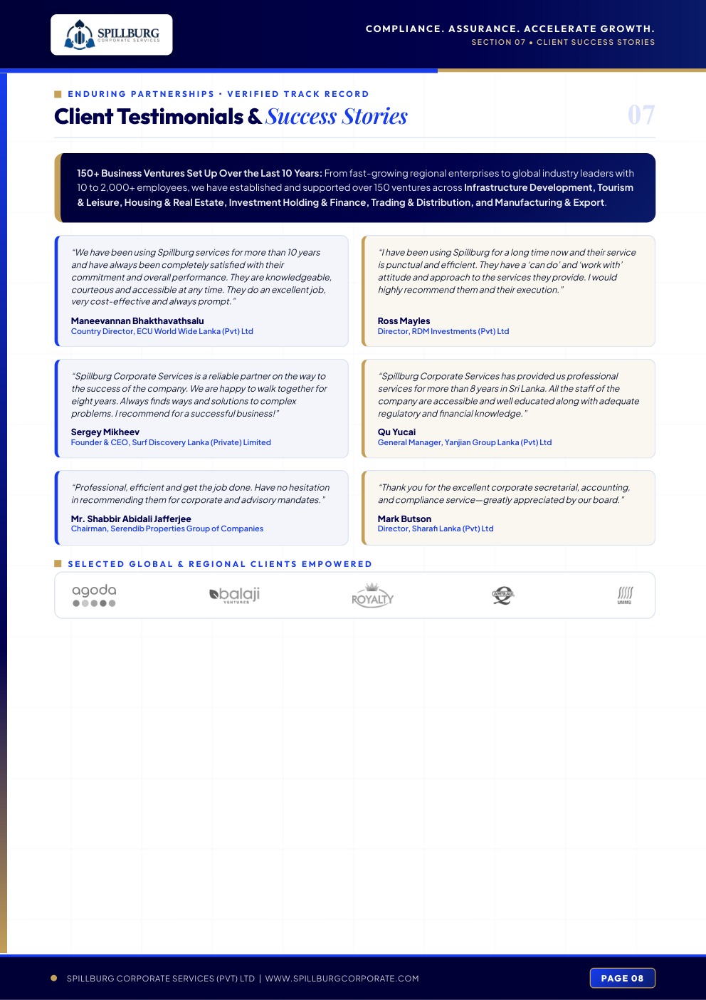 |

---

### 3. Spillburg Logistics 1 (Pvt) Ltd
*Theme: Maritime Slate (`#0B1120`), Industrial Blue (`#0284C7`) & Telemetry Accents*

| Page 01: Technical Fleet Cover | Page 03: Management Team |
| :---: | :---: |
| 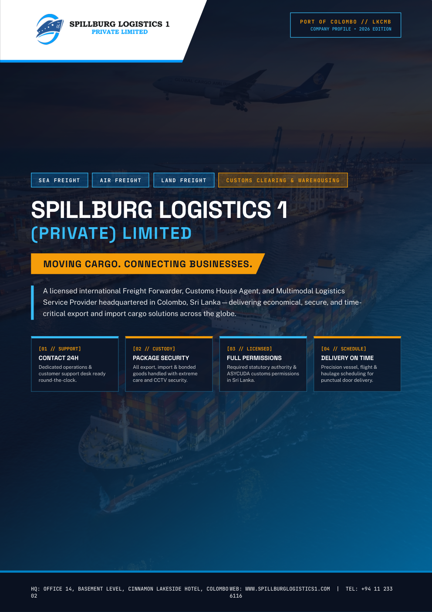 | 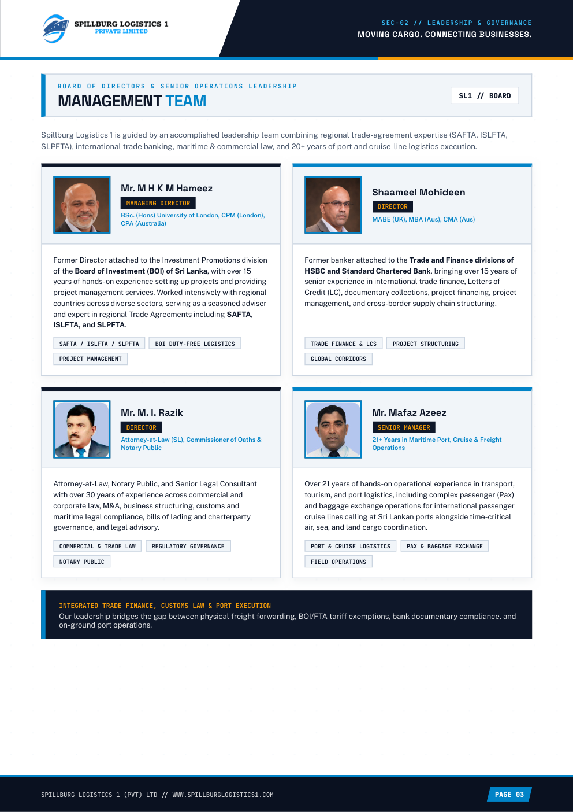 |
| **Page 06: Multi-Country Consolidation (MCC)** | **Page 08: Execution Workflow & Fleet** |
| 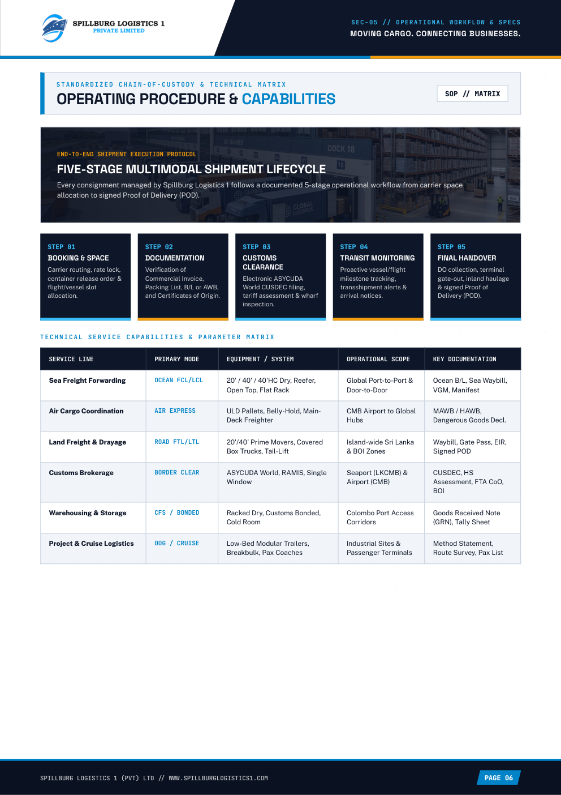 | 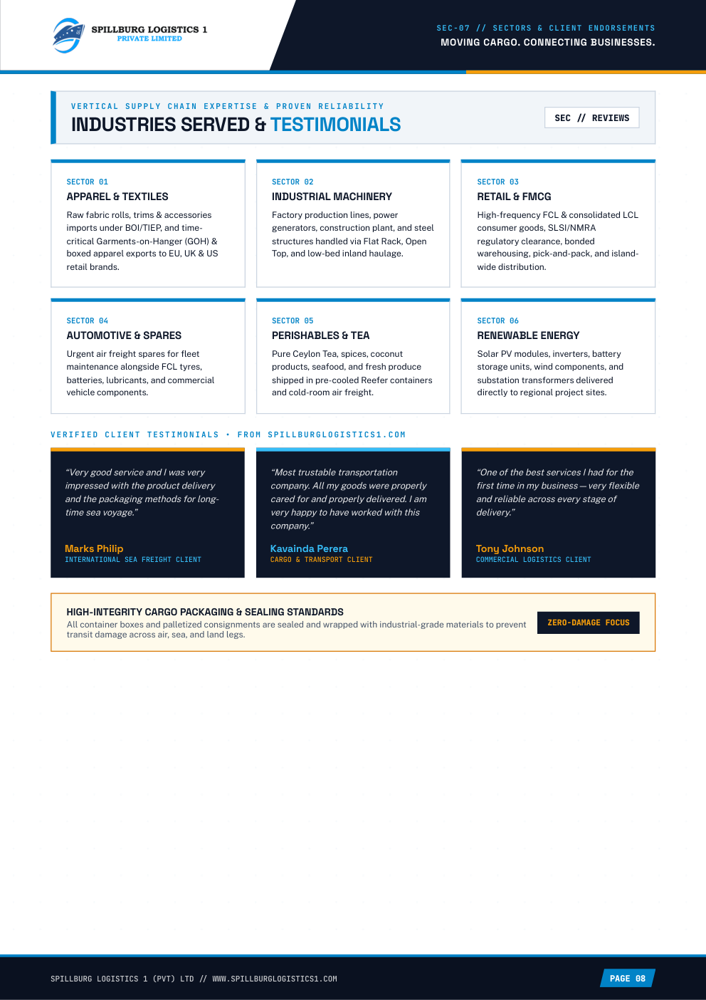 |

---

### 4. Spillburg Holdings (Pvt) Ltd
*Theme: Group Conglomerate Heritage & Multi-Sector Holdings*

| Page 01: Group Cover | Page 03: Group Vision & Leadership |
| :---: | :---: |
| 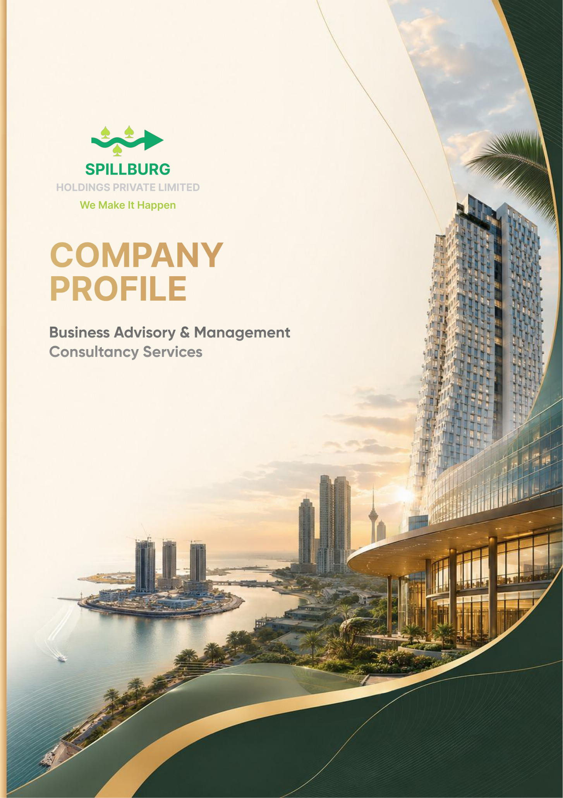 | 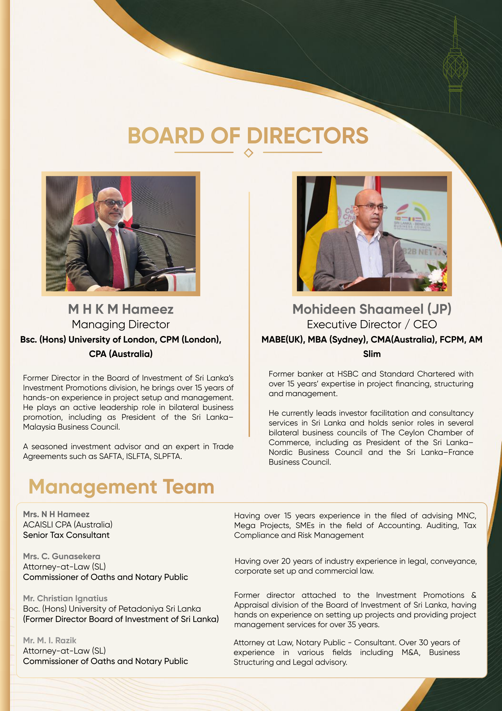 |

---

## 🎨 Editing in Figma

All profiles have been pre-compiled into dedicated vector `.svg` pages and native multi-page PDFs for editing in Figma:

### Option A: Drag-and-Drop Vector SVGs (Preserves layers & geometry)
Drag the `.svg` files directly from any company's `figma_svg_pages/` folder into your Figma canvas:
- `destination consultancy/figma_svg_pages/Page 01.svg` to `Page 09.svg`
- `spillburg corporate services/figma_svg_pages/Page 01.svg` to `Page 09.svg`
- `spillburg logistics/figma_svg_pages/Page 01.svg` to `Page 09.svg`

### Option B: Native PDF Import (All 9 pages at once)
Drag the master `Company Profile - 2026.pdf` directly into the Figma file browser or onto any canvas. Figma automatically splits and parses all 9 pages into editable vector artboards.

---

## 📁 Repository Directory Structure

```text
spillburg_profiles/
├── .github/
│   └── workflows/
│       ├── deploy-pages.yml             # Automated GitHub Pages showcase build
│       └── package-releases.yml         # Automated GitHub Release ZIP packaging
├── destination consultancy/
│   ├── Company Profile - 2026.pdf       # 9-page vector master PDF (300 DPI)
│   ├── Company Profile - 2026.pptx      # 9-slide editable PowerPoint presentation
│   ├── source_template/index.html       # Responsive HTML5/CSS3 master layout (1920x1080)
│   ├── individual_pages/                # Single-page high-resolution PDFs (Page 01–09)
│   ├── figma_svg_pages/                 # Vector SVG pages for Figma (Page 01–09)
│   └── assets/                          # Authentic logos, director photos & branded QR
├── spillburg corporate services/
│   ├── Company Profile - 2026.pdf
│   ├── Company Profile - 2026.pptx
│   ├── source_template/index.html
│   ├── individual_pages/
│   ├── figma_svg_pages/
│   └── assets/
├── spillburg logistics/
│   ├── Company Profile - 2026.pdf
│   ├── Company Profile - 2026.pptx
│   ├── source_template/index.html
│   ├── individual_pages/
│   ├── figma_svg_pages/
│   └── assets/
├── spillburg holdings/                  # Group master archives, v3 release & stock media
├── docs/
│   ├── index.html                       # Web showcase portal for GitHub Pages
│   ├── screenshots/                     # High-resolution documentation preview PNGs
│   ├── DESIGN_SYSTEM.md                 # Typography, colors, and styling rules
│   ├── DEPLOYMENT.md                    # Build, render, and deployment instructions
│   └── RELEASES.md                      # Changelog and release tagging guide
└── scratch/                             # Python rendering, QR generation & SVG scripts
```

---

## 🏷️ Repository Tags & Topics

When configuring the repository on GitHub, apply the following topics:

```text
spillburg, company-profile, corporate-branding, design-system, figma, presentation-deck, sri-lanka, logistics, corporate-services, investment-advisory, html2pdf, vector-graphics, svg-pages, annual-report, big-four, print-ready
```

---

## 📄 License

Proprietary and Confidential. Copyright © 2026 Spillburg Group. All rights reserved.  
Unauthorized distribution, copying, or replication of visual identity assets is strictly prohibited.
